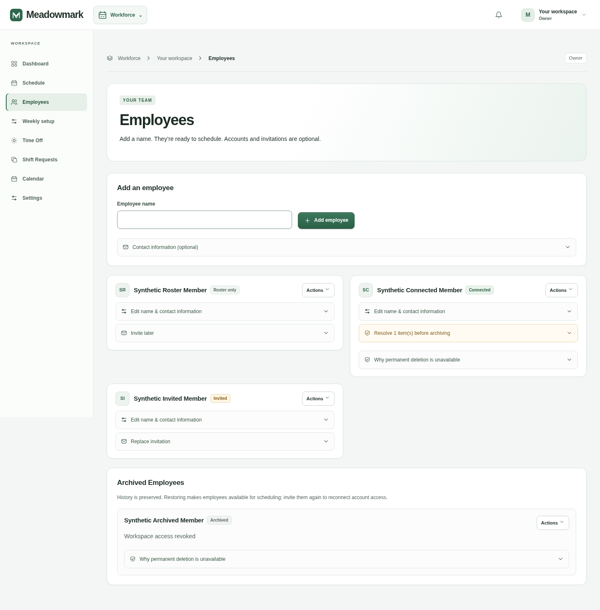
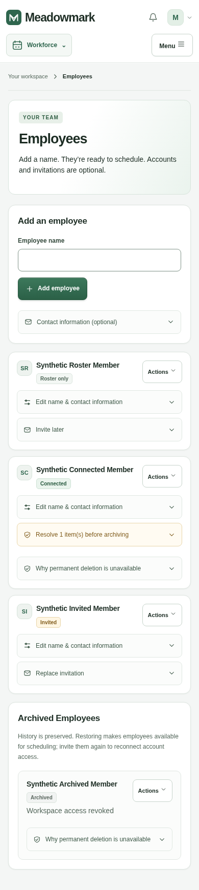
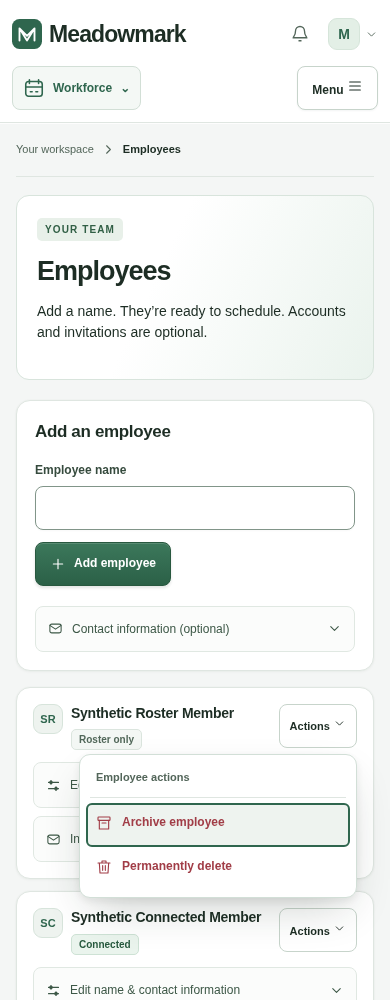
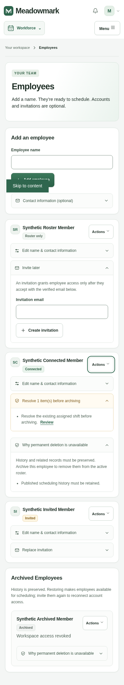

# Employees screen refinement

This change is limited to Employees UI and its browser fixtures. It reuses the premium theme, Radix Popover and the existing confirmation dialog. No dependency, database, migration, server-action or permission changes are included.

- Compact roster cards use an identity header with a badge beside the employee name. Connected, invited, roster-only and archived statuses keep their existing meaning.
- Every active/archived employee has an **Actions** popover. Restore appears above the divider for archived employees; archive and permanent deletion are grouped below it. Existing blockers still disable actions, with readable explanations.
- Edit/contact information, archive blockers, deletion explanations and invitations use reusable accordion rows with icons, right chevrons, hover/focus states and animated content. Closed content is inert and hidden from assistive technology; reduced motion removes the transition. Native invalid-field validation reopens a closed contact section when needed.
- The original `manageEmployee` form fields and action are used after explicit confirmation. The action popover closes before the modal opens. Cancelling or pressing Escape leaves records untouched and returns focus to Actions. Pending submissions disable the trigger.

## Rendered screenshots

All records are synthetic local fixtures, including connected, invited, roster-only, blocked and archived employees. Captures use Chromium at 1440px and 390px.

| Mobile cards | Actions popover | Expanded content |
| --- | --- | --- |
|  |  |  |

## Verification

`node tests/browser/employees-smoke.cjs` checks the populated Employees screen, responsive overflow, status badges, collapsed action visibility, Enter/Space/Tab navigation, Escape/focus restoration, accordion motion/reduced motion, invalid-contact validation, disabled archive/delete actions, cancellation, and exactly-once archive/restore/delete submissions through the original server action. Axe audits cover the screen, open popover and confirmation dialog. The fixture changes only the targeted synthetic record; other employees remain present.

The test uses the same local fixture ports and browser dependencies as the existing redesign suite. Run it sequentially with `node tests/browser/redesign-smoke.cjs`. Chromium is `/usr/bin/chromium`; axe-core is loaded from `work/browser-tools/node_modules/axe-core/axe.min.js`.

Dependency install, typecheck, production build and all 151 existing behavior tests passed. Both the focused Employees browser suite and the existing redesign browser regression passed, including axe checks. The project has no lint script/configuration; `git diff --check` is used for whitespace validation.

Manual review: Safari/Firefox and assistive technology on the popover/accordion focus flow; very long names and blocker messages. The new styles are scoped to this screen.
