# Meadowmark component redesign

This redesign replaces the earlier cosmetic pass with reusable interactive components and a new product layout. Existing sage branding, light theme, destinations, permission checks, server actions and database behavior remain intact.

## Rendered audit

The baseline was the previous merged UI pass (`53c8d05`). Its rendered settings used browser select menus, wide green submit bars, undifferentiated forms and tall empty panels. Desktop workspace destinations were usually hidden behind Menu. Dashboard cards stacked into a long, repetitive mobile page; onboarding used a browser-default progress bar. Native confirmation prompts and inconsistent date controls remained.

## Components and screens

| Component | Result |
| --- | --- |
| Workspace shell | Persistent 224px navigation rail on desktop, icon navigation, breadcrumb context and role badge. Mobile retains an accessible menu. All existing destinations and role restrictions are unchanged. |
| Select | Radix Select option lists, selected-item checks, typeahead, arrow keys, Escape, focus restoration and viewport collision handling. All existing selects migrate to this component. Original HTML field names/values, controlled change handlers, native validation, fieldset disabling and form reset are retained through the underlying select. Native select markup is retained before hydration; page-level streaming remains Next.js behavior. |
| DatePicker | Radix Popover and React DayPicker calendar, keyboard navigation, native direct date entry, native min/max/required constraints and calendar bounds. Dates remain local calendar strings; no timestamp conversion is introduced. Popovers inside native dialogs are mounted within that dialog. |
| Button / ButtonLink | Compact primary, secondary, danger and ghost variants; meaningful SVG action icons, pressed/hover/focus states and pending indicators. Native button type, submitter name/value, disabled state and server-action behavior are retained. |
| Checkbox | Real native checkbox semantics with a custom sage checked state. Space, required constraints, controlled checked values, reset and forced-colors fallback are preserved. |
| Card / MetricCard / PageHeader / SectionTitle | Sage-tinted page headers, icon section headings, distinct dashboard metrics and action footers, lighter surfaces and clearer hierarchy. |
| ConfirmationDialog / ConfirmForm | Native modal focus containment, accessible title/description, Cancel as the initial focus and Escape dismissal. Employee lifecycle forms submit their existing action only after confirmation; notification retry also retains explicit consent. |
| Tables, lists and disclosures | Unified table headers and focus states, compact card lists, styled native disclosures, clearer forms and responsive overflow behavior. |

Applied across manager and employee dashboards, scheduling and copy-week, weekly setup, employees and lifecycle actions, time off and availability, shift requests, time clock and corrections, payroll/settings, notifications/preferences/delivery, calendar integration, workspace selection, onboarding, login/signup/password/account pages, demo and kiosk actions. The Connect product picker shares the surfaces; Connect has no implemented application screen in this checkout.

Only three direct runtime packages were added: Radix Select, Radix Popover and React DayPicker. These provide accessible selection, layering and calendar keyboard behavior. Icons are local SVGs. No database/schema/migration files or business-action modules changed.

## Desktop comparison — 1440px

Screenshots show the actual application using identical synthetic fixture data before and after. Empty-state fixtures are intentional; populated payroll/timecard and kiosk states are exercised separately by the existing browser suite.

| Before | After |
| --- | --- |
| 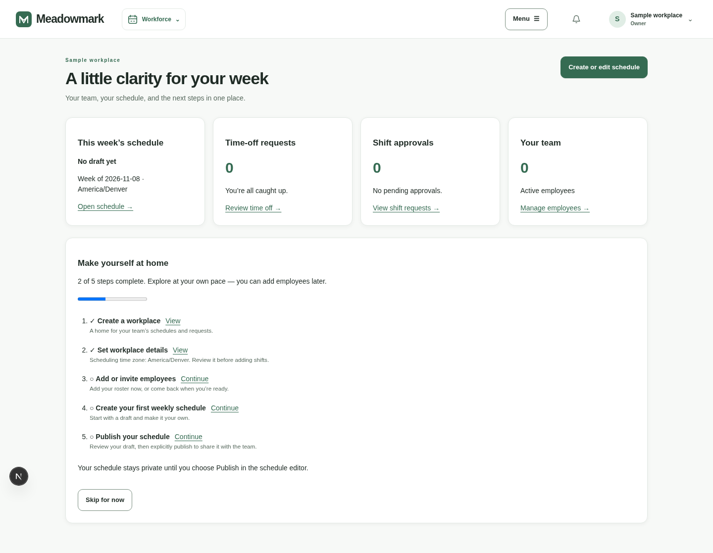 | 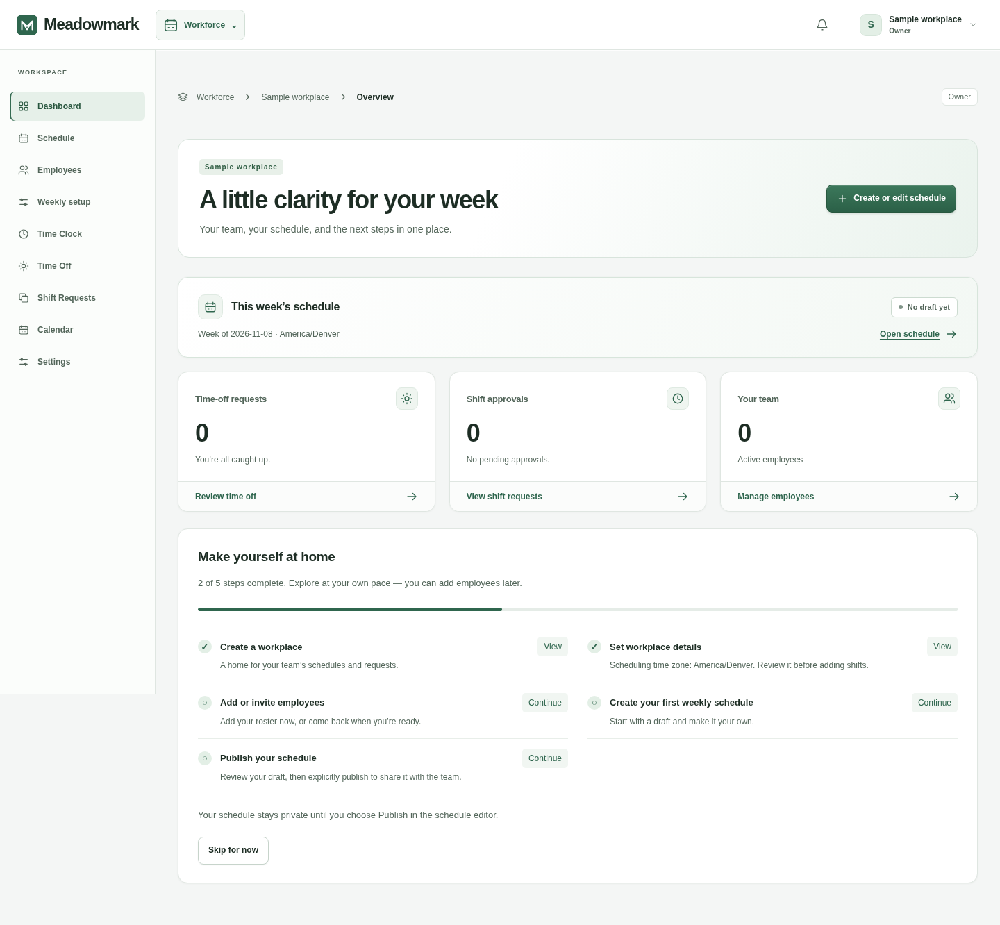 |
| 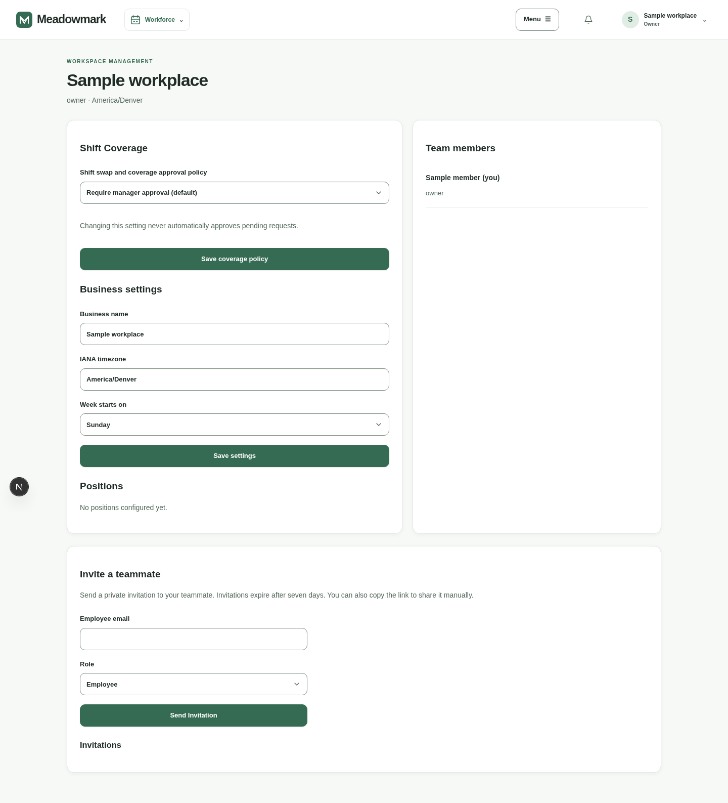 | 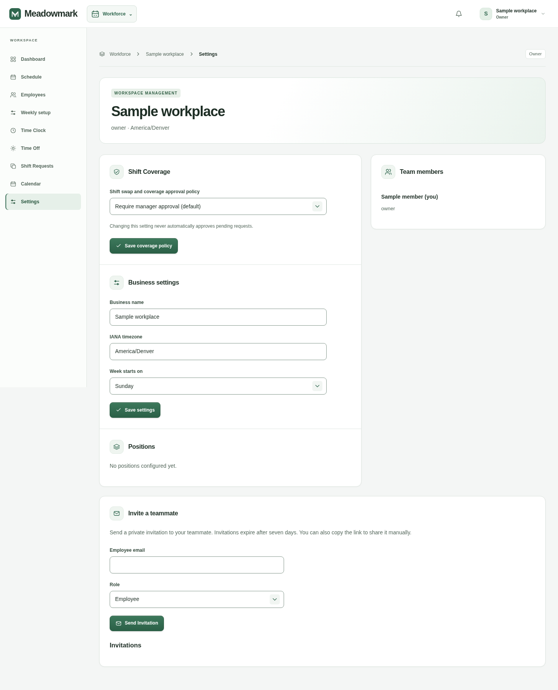 |

## Mobile comparison — 390px

| Before | After |
| --- | --- |
| 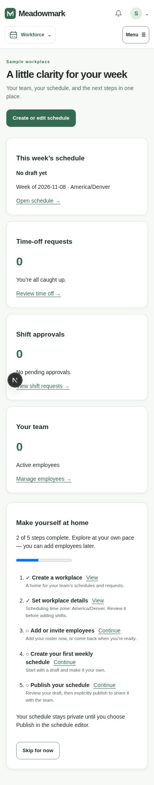 | 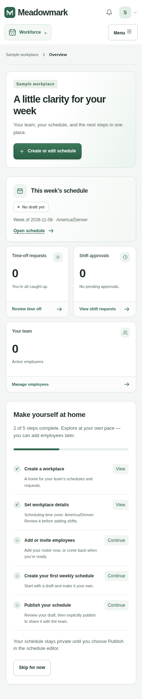 |
| 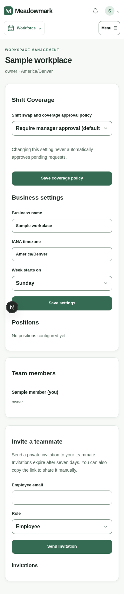 | 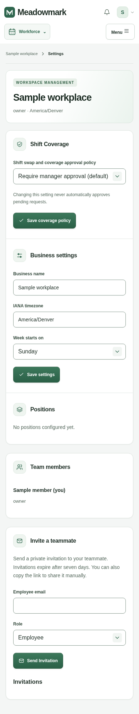 |

## Interactive controls

| Custom select | Calendar in copy-week dialog | Confirmation |
| --- | --- | --- |
| 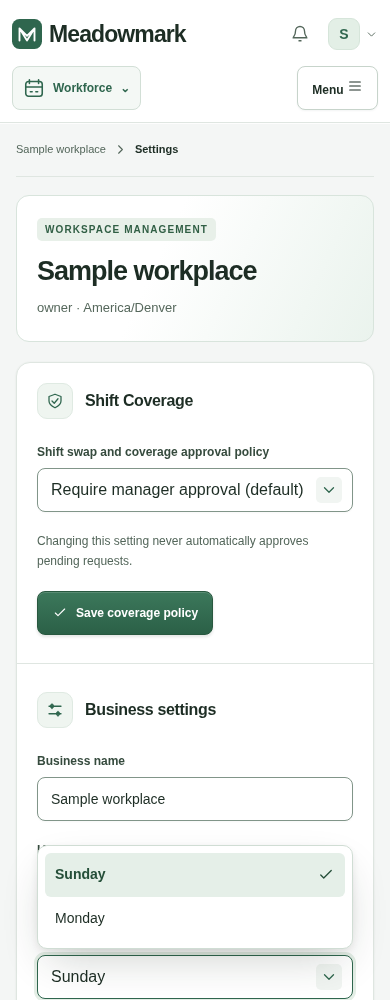 | 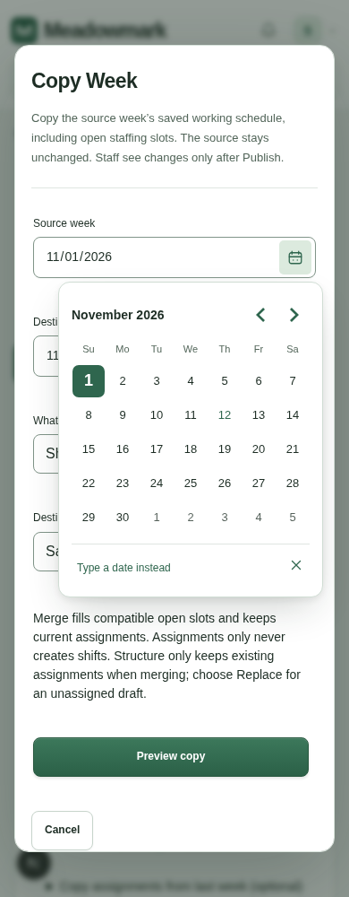 | 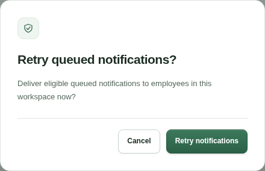 |

## Verification and reproduction

Run `npm install`, `npm run typecheck`, `NEXT_TELEMETRY_DISABLED=1 npm run build`, and `npm test`. For the existing browser suites, run `node tests/browser/navigation-smoke.cjs`, `node tests/browser/launch-smoke.cjs`, and `npm run test:payroll:browser` (which also runs the kiosk browser checks). Run the suites sequentially because their local fixtures use shared ports. The project has no lint script or lint configuration.

`node tests/browser/redesign-smoke.cjs` captures screenshots in `work/redesign/after/` and exercises select mouse/keyboard values and reset, nested dialog selections, date changes, disabled fieldsets, checkbox Space behavior, required-select error forwarding, native server markup with JavaScript disabled, cancellation and confirmed employee form submission. It runs axe WCAG A/AA checks on open selects, calendars and confirmation dialogs. Browser dependencies: installed Chromium and axe-core at `work/browser-tools/node_modules/axe-core/axe.min.js` (install axe-core locally with `npm install --prefix work/browser-tools --no-package-lock axe-core`). `CAPTURE_PHASE=before` is intended for running the capture script against the baseline checkout, not for relabeling redesigned screens.

The optional native PostgreSQL suite is `SHIFTLY_TEST_DATABASE_URL=<disposable-local-admin-url> npm run test:postgres`. It refuses remote hosts and creates/drops only its own test databases. No live database is used.

## Validation results

- `npm install`, typecheck and optimized production build: passed.
- `npm test`: 151 tests passed.
- Native PostgreSQL suite on a disposable localhost PostgreSQL 17 container: 18 tests passed; the test container was removed afterwards.
- Desktop/mobile screenshot and component regression suite: passed, including open-control axe checks, required-select validation, native server markup, disabled fieldsets, keyboard/escape/focus behavior, confirmed form submission and browser/hydration error checks.
- Existing navigation, launch/accessibility and payroll/timecard/kiosk browser suites: passed. Navigation covers owner and employee roles at 390, 768, 1024, 1280, 1440 and 1800px.
- `git diff --check`: passed. No lint command/configuration is defined.

## Manual review

- Safari/iOS and Firefox: touch selection, direct date typing and native date constraints, screen-reader announcements and soft keyboard behavior. Automated screenshots here use Chromium.
- Dense real schedules, long employee/position names, long copy previews, correction forms and printed schedules/PDFs. Local fixtures cannot represent every production record shape.
- Assistive technology and OS high contrast mode. Open-control axe checks supplement keyboard testing; they do not replace human screen-reader review.

Reduced motion disables component entrance animations and pending-indicator rotation. Desktop and mobile maintain visible focus rings, and native checkboxes return to platform rendering in forced-colors mode.
