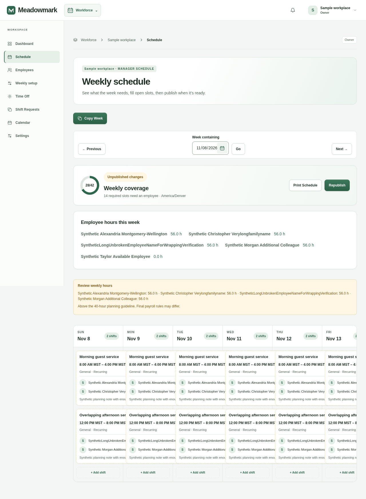
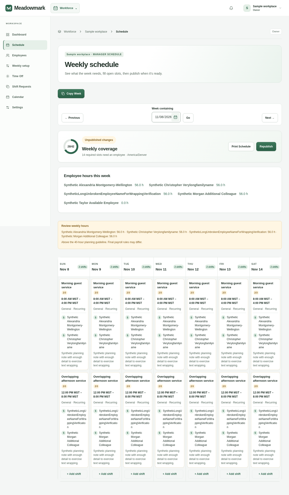
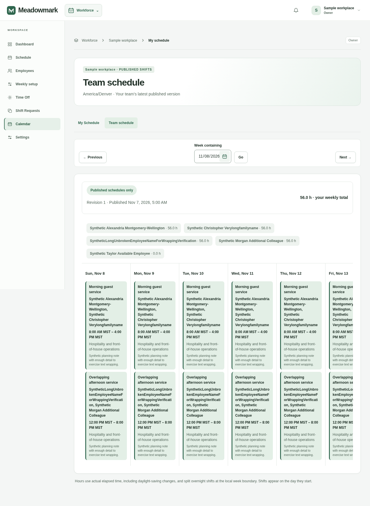
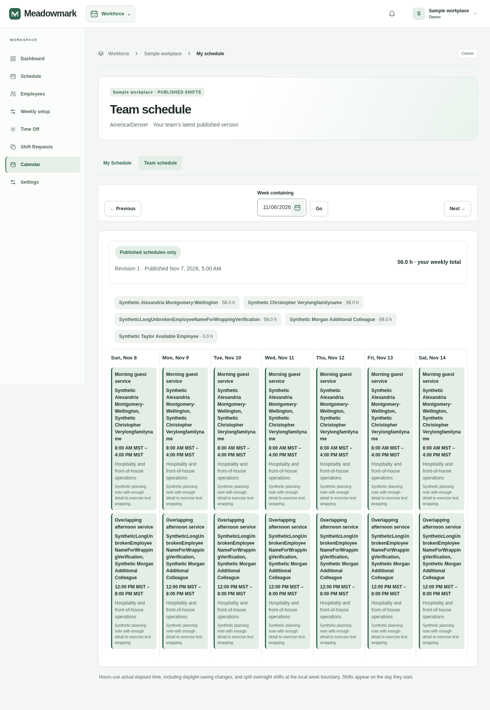

# Responsive Schedule and Calendar weekly views

## Rendered findings

The premium sidebar reduced the content area while the original coverage grid, day grid and employee table retained 1,218px, 1,180px and 1,160px minimum widths. At a 1280px viewport, Schedule's content could provide about 990px and Calendar's about 938px. Parent scroll regions concealed the extra width from page-level overflow checks, so checking the document alone did not detect the problem. Long unbroken employee names also overflowed individual coverage cards, even on wider screens.

## Focused fix

- Wide views use seven `minmax(0, 1fr)` columns, a shrinkable table with a proportional employee column, and `min-width: 0` through their wrappers. The weekly content uses the width remaining beside the desktop sidebar.
- Names, times, positions, notes and controls wrap within their cells. Main card text remains at least 12px; it is not compressed to fit the week. No horizontal clipping is used to hide overflowing shift content.
- Below **820px of actual calendar content width**, a shared layout controller displays seven day buttons in one row plus a selected-day detail view. Shift counts reflect the current view's actual grouped shifts. Arrow keys, Home/End, Enter/Space and normal Tab navigation remain available. All day nodes stay mounted; the layout determines visibility. Desktop shows all seven day columns regardless of the compact view's selection.
- On compact team calendars, the weekly employee-hours summary moves below the selected-day details. Carry-in shifts and existing week/timezone notes remain outside the selected-day filtering.
- Assignment editing uses the existing Radix Popover, with a bounded width/height and vertical scrolling for long content. Nested selects, conflict checks, staffing controls and callbacks are unchanged. Escape closes the inner select first, then the assignment editor and restores focus.
- Print uses the existing dedicated schedule and retains all seven days. The responsive rules are scoped to screen media.

No schemas, policies, server actions, permission checks, shift grouping/time calculations or scheduling rules changed. No dependencies were added.

## Desktop before and after — 1280px

Identical synthetic data contains two overlapping shifts per day, two assigned employees per shift, long names (including an unbroken name) and planning notes. These are captures of the real local Next pages. The baseline is `dbc9477`, before this fix.

| View | Before | After |
| --- | --- | --- |
| Manager Schedule |  |  |
| Team Calendar |  |  |

Personal Calendar: [before](before-employee-personal-1280.png) · [after](after-employee-personal-1280.png).

## Mobile comparisons — 390px

Full-page captures are linked because the previous stacked-day layout produces very tall images.

| View | Before | After |
| --- | --- | --- |
| Manager Schedule | [Before](before-manager-schedule-390.png) | [Seven-day overview and selected-day details](after-manager-schedule-390.png) |
| Team Calendar | [Before](before-manager-calendar-390.png) | [Seven-day overview and selected-day details](after-manager-calendar-390.png) |
| Personal Calendar | [Before](before-employee-personal-390.png) | [Seven-day overview and selected-day details](after-employee-personal-390.png) |

## Verification

`node tests/browser/weekly-layout.cjs` renders **35 role/view/width combinations**: manager Schedule, manager team/personal Calendar, and employee team/personal Calendar at **375, 390, 768, 1024, 1280, 1440 and 1920px**. It verifies:

- Zero document, grid and parent horizontal overflow, plus visible day/card bounds and readable body text.
- Seven simultaneous desktop columns, or seven compact day buttons in one row; selecting Saturday and keyboard navigation to other days updates the visible detail cells.
- Multiple assignments, overlapping shifts, long/unbroken names and notes.
- Assignment popover bounds, nested employee selection and Escape/focus behavior; existing overlap rejection remains disabled while a non-overlapping employee can be selected.
- Week navigation link values, date-picker and Copy Week dialog viewport bounds, and read-only employee views.
- Axe WCAG A/AA audits of the weekly view and open assignment editor; no browser errors.

[Before measurements](before-measurements.json) and [after measurements](after-measurements.json) record the page/grid/parent checks. The baseline has four views; the final matrix additionally checks the manager personal calendar.

The fixture and screenshots contain no real employee information. `CAPTURE_PHASE=before` is for running the capture script against the baseline source, not relabeling the redesigned source. Optional `WEEKLY_TEST_WIDTHS=1280` limits local debugging; default validation always covers all seven widths. As with other local browser suites, Chromium and axe-core under `work/browser-tools/node_modules/axe-core/axe.min.js` are required. Run browser suites sequentially because their local fixture ports are shared.

Install, typecheck, production build, all 151 behavior tests, existing launch/accessibility tests and the redesign browser regression passed. The project has no lint configuration/script; `git diff --check` passes.

Manual review: Safari/Firefox container-query and popup rendering, very dense production weeks, and PDF output. Automated browser evidence uses Chromium.
